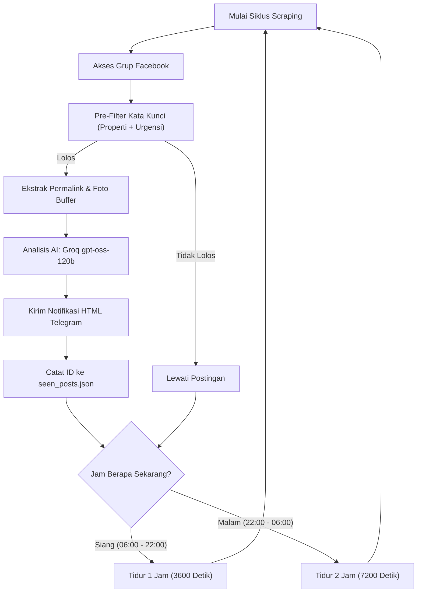

# 🏢 Real Estate Intelligence Bot: Facebook Groups Scraper + Groq AI + Telegram Alerts

> **Engine Otomatisasi & Pemantau Properti Facebook 24/7** bertenaga **Playwright**, **Groq AI (Model: `openai/gpt-oss-120b`)**, dan **Telegram Bot API**.  
> Dirancang khusus dengan standar komersial (*production-ready / siap jual*) untuk agen properti, investor real estate, dan flipper yang memburu listing **BU (Butuh Uang)**, **Lelang**, **Under Market**, dan **Harga Miring** langsung dari grup-grup Facebook secara *real-time*.

---

## 📑 Daftar Isi
1. [Fitur Utama](#-fitur-utama)
2. [Daftar Berkas yang DILARANG Di-upload ke Git](#-daftar-berkas-yang-dilarang-di-upload-ke-git)
3. [Struktur Folder & Arsitektur Project](#-struktur-folder--arsitektur-project)
4. [Petunjuk Konfigurasi Sistem](#-petunjuk-konfigurasi-sistem)
5. [Panduan Instalasi & Menjalankan Bot](#-panduan-instalasi--menjalankan-bot)
6. [Penjadwalan Operasional (Day & Night Mode)](#-penjadwalan-operasional-day--night-mode)
7. [Format Notifikasi Telegram](#-format-notifikasi-telegram)
8. [Tips Keamanan & Anti-Checkpoint Facebook](#-tips-keamanan--anti-checkpoint-facebook)
9. [Troubleshooting & Solusi Masalah](#-troubleshooting--solusi-masalah)

---

## 🌟 Fitur Utama

- 🔄 **Watchdog 24/7 Resilient Engine**:
  - Berjalan tanpa henti dengan proteksi crash otomatis (*try-except global* + *auto-recovery*).
  - Jika terjadi kendala jaringan beruntun, bot otomatis memasuki mode *cooldown* 10 menit tanpa mematikan proses.
- 🕒 **Penjadwalan Otomatis (Operational Hours)**:
  - **Mode Siang (06:00 – 22:00)**: Scraping setiap **1 jam sekali**.
  - **Mode Malam (22:00 – 06:00)**: Scraping setiap **2 jam sekali** (meniru pola tidur manusia dan menghemat kuota).
- 🛡️ **Anti-Deteksi Facebook Handal**:
  - Menggunakan Chromium Playwright native **tanpa dependensi `playwright-stealth`** yang sering menimbulkan bug dan crash.
  - Injeksi override `navigator.webdriver`, spoofing plugin, timezone `Asia/Jakarta`, dan browser header modern.
  - **Randomized Delay (1–30 detik)** antar grup Facebook untuk mencegah pembatasan akses.
- 🎯 **Filter Presisi Dua Tingkat**:
  - **Tingkat 1 (Pre-filter Kata Kunci Lokal)**: Wajib memuat kata kunci **Properti** (*dijual, jual, rumah, ruko, tanah*) **DAN** kata kunci **Urgensi/Peluang** (*bu, butuh uang, lelang, murah, miring, under market*). Dilengkapi regex word-boundary agar kata `bu` tidak keliru mendeteksi kata `ibu` atau `kebun`.
  - **Tingkat 2 (Analisis Tajam Groq AI)**: Membedah teks postingan dengan model **`openai/gpt-oss-120b`** untuk mengekstrak spesifikasi, estimasi selisih harga pasar, potensi cuan, dan nomor kontak WA.
- ✈️ **Notifikasi Telegram Anti-Blokir**:
  - Format pesan murni **HTML Telegram** (bukan Markdown rapuh) agar tidak pernah terkena entity parse error.
  - Foto utama listing diunduh ke **memory buffer (`io.BytesIO`)** menggunakan User-Agent browser, lalu diunggah via multipart upload (`files={"photo": ...}`) sehingga **tidak akan diblokir oleh CDN Facebook** (403 Forbidden).
  - **Fallback 3 Tingkat**: Foto Multipart + HTML Caption ➔ Pesan Teks HTML ➔ Pesan Teks Polos (strip HTML).
  - Tautan aktif terpisah:
    - 🔗 **Buka Postingan Asli** (Permalink / Post URL)
    - 👥 **Buka Grup Facebook** (Group URL)
- 🗄️ **Deduplikasi Postingan Deterministik**:
  - Riwayat postingan (`seen_posts.json`) dikelola dengan ID numerik Facebook asli dan fallback hash SHA-256 (bukan fungsi `hash()` bawaan Python yang nilainya berubah setiap script di-restart).
  - Penulisan berkas secara atomik (`.tmp` ➔ replace) dengan auto-trimming maksimal 5.000 item.

---

## 🚫 Daftar Berkas yang DILARANG Di-upload ke Git

Demi keamanan data pribadi, keamanan token rahasia, serta pencegahan pembajakan akun Facebook Anda, **JANGAN PERNAH** meng-upload berkas-berkas berikut ke repository publik maupun privat. Berkas-berkas ini telah otomatis didaftarkan pada [`.gitignore`](.gitignore):

| Nama Berkas / Folder | Alasan Keamanan Mengapa Dilarang Di-upload | Solusi Aman |
| :--- | :--- | :--- |
| **`.env`** | **CRITICAL SECURITY!** Berisi API Key rahasia (`GROQ_API_KEY`, `TELEGRAM_TOKEN`, `CHAT_ID`). Jika terunggah, bot dan akun Anda dapat disalahgunakan pihak lain. | Gunakan berkas template [`.env.example`](.env.example) yang aman dan tidak memuat token asli. |
| **`fb_state.json`** | **CRITICAL PRIVACY!** Berisi cookie otentikasi sesi aktif Facebook Anda (`c_user`, `xs`, `fr`, dan localStorage). Siapapun yang memiliki berkas ini dapat langsung mengakses akun Facebook Anda tanpa password! | Biarkan berkas ini digenerate secara lokal di komputer/server Anda menggunakan `save_session.py`. |
| **`seen_posts.json`** & **`sent_posts.json`** | Berkas cache riwayat ID postingan lokal. Jika di-upload, akan terjadi konflik histori saat dijalankan di server lain. | Biarkan bot membuatnya secara otomatis saat pertama kali berjalan. |
| **`venv/`**, **`.venv/`**, **`env/`** | Berisi ribuan berkas virtual environment Python lokal (~500MB+). Membebani repository dan tidak portabel antar sistem operasi. | Buat venv baru di server target dengan `python -m venv venv`, lalu install via `requirements.txt`. |
| **`__pycache__/`**, **`*.pyc`** | Berkas kompilasi bytecode Python lokal yang otomatis dibuat oleh interpreter. | Diabaikan otomatis oleh `.gitignore`. |
| **`*.log`**, **`logs/`** | File log eksekusi bot yang mungkin memuat URL postingan atau data riwayat operasi lokal. | Diabaikan otomatis oleh `.gitignore`. |
| **`list grup*.txt`**, **`*.tmp`** | Catatan pribadi atau file draft lokal pengguna yang tidak relevan dengan source code utama. | Masukkan URL grup langsung ke variabel `FACEBOOK_GROUPS` di file `.env`. |

---

## 📁 Struktur Folder & Arsitektur Project

```text
facebook-property-bot/
├── config.py              # Konfigurasi terpusat (membaca .env, keywords, intervals, validasi)
├── storage.py             # Manajemen atomic storage untuk fb_state.json & seen_posts.json
├── ai_analyzer.py         # Analisis Groq AI ('openai/gpt-oss-120b') & sanitasi Telegram HTML
├── telegram_notifier.py   # Pengiriman Telegram: multipart buffer photo upload & 3-level fallback
├── scraper.py             # Core Playwright engine: scraping feed FB, anti-detection, pre-filter
├── main_bot.py            # Entry point produksi 24/7 dengan Watchdog & Operational Scheduler
├── save_session.py        # Tool interaktif login Facebook & penyimpan sesi cookies
├── test_system.py         # All-in-One diagnostic tool (health check 5 komponen sebelum running)
├── dashboard.py           # Dashboard monitoring visual berbasis web (Streamlit)
├── test-groq.py           # Skrip pengujian koneksi dan model Groq API
├── api-tester.py          # Skrip pengujian multi-key Google Gemini API
├── .env.example           # Template konfigurasi environment (aman di-commit ke Git)
├── .gitignore             # Daftar proteksi berkas sensitif yang dilarang masuk Git
├── requirements.txt       # Daftar dependensi library Python
└── readme.md              # Buku panduan lengkap (file ini)
```

---

## ⚙️ Petunjuk Konfigurasi Sistem

Semua parameter operasional bot dapat diatur dengan mudah melalui file **`.env`** (atau di file **`config.py`**).

### 1. Di mana Memasukkan API Key?
Buka file **`.env`**:
```env
# GROQ API Key (Wajib - Dapatkan gratis di https://console.groq.com/keys)
GROQ_API_KEY="gsk_xxxxxxxxxxxxxxxxxxxxxxxxxxxxxxxxxxxxxxx"
GROQ_MODEL="openai/gpt-oss-120b"

# GEMINI API Keys (Opsional - Sebagai fallback jika Groq limit/down)
GEMINI_API_KEYS="key_gemini_1,key_gemini_2"
```

### 2. Di mana Memasukkan Token & Chat ID Telegram?
Buka file **`.env`**:
```env
TELEGRAM_TOKEN="8853724954:AAEv4p6jczADbnqQPNHPsFOpZfR_lGdRO64"
CHAT_ID="-1004492064878"
```
- **`TELEGRAM_TOKEN`**: Dapatkan dari bot [@BotFather](https://t.me/BotFather) di Telegram via perintah `/newbot`.
- **`CHAT_ID`**: ID grup, channel, atau user tujuan. Anda bisa mendapatkan ID ini dengan menambahkan bot [@userinfobot](https://t.me/userinfobot) ke grup/chat Anda.

### 3. Di mana Memasukkan Daftar Grup Facebook Target?
Buka file **`.env`** pada variabel `FACEBOOK_GROUPS`. Masukkan link grup target dipisahkan tanda koma:
```env
FACEBOOK_GROUPS="https://facebook.com/groups/837683697529067/,https://facebook.com/groups/761267294605013/,https://facebook.com/groups/372288268521407/"
```

### 4. Di mana Mengatur Kata Kunci Properti & Urgensi?
Daftar kata kunci bawaan sudah tersedia lengkap di [`config.py`](config.py). Jika ingin mengubah atau menambah kata kunci tanpa mengedit kode, cukup isi di file **`.env`**:
```env
# Kata Kunci Kategori Properti (Tingkat 1A)
PROPERTY_KEYWORDS="dijual,jual,rumah,ruko,tanah,kavling,kost,gudang,apartemen,over kredit"

# Kata Kunci Urgensi / Peluang Cuan (Tingkat 1B)
URGENCY_KEYWORDS="bu,butuh uang,b.u,lelang,murah,miring,under market,turun harga,cepat,butuh dana,obral,rugi,hitung tanah"
```

---

## 🚀 Panduan Instalasi & Menjalankan Bot

### Langkah 1: Clone Repository & Buat Virtual Environment
Buka terminal (Command Prompt / PowerShell / Bash):
```bash
git clone <URL_REPOSITORY_ANDA>
cd facebook-property-bot

# Buat virtual environment
python -m venv venv

# Aktifkan virtual environment
# Windows:
.\venv\Scripts\activate
# Linux/macOS:
source venv/bin/activate
```

### Langkah 2: Install Dependensi & Browser Playwright
```bash
pip install -r requirements.txt
playwright install chromium
```

### Langkah 3: Siapkan File Konfigurasi `.env`
Salin template `.env.example` menjadi `.env`:
```bash
# Windows PowerShell:
Copy-Item .env.example .env

# Linux/macOS:
cp .env.example .env
```
Buka file `.env` dan masukkan `GROQ_API_KEY`, `TELEGRAM_TOKEN`, `CHAT_ID`, serta daftar grup Facebook Anda.

### Langkah 4: Simpan Sesi Login Facebook (`fb_state.json`)
Jalankan script session saver untuk login sekali saja:
```bash
python save_session.py
```
1. Browser Chromium akan terbuka secara otomatis.
2. Masukkan email & password akun Facebook Anda (sangat disarankan menggunakan akun tumbal / akun khusus bot).
3. Selesaikan verifikasi 2FA/OTP hingga Anda berada di halaman **Beranda Facebook**.
4. Kembali ke terminal dan tekan **`[ENTER]`**.
5. File sesi `fb_state.json` akan otomatis tersimpan.

### Langkah 5: Uji Diagnostik Sistem (Health Check)
Sebelum menjalankan bot secara penuh, jalankan pengujian sistem lengkap:
```bash
python test_system.py
```
Script ini akan memverifikasi 5 komponen:
- [x] Validitas file konfigurasi `.env`
- [x] Validitas berkas sesi `fb_state.json`
- [x] Akurasi pre-filter kata kunci properti & urgensi
- [x] Kecepatan & respon Groq AI model `openai/gpt-oss-120b`
- [x] Pengiriman notifikasi ke bot Telegram

Jika hasil **5/5 Lolos**, sistem siap 100% untuk mode produksi!

### Langkah 6: Jalankan Bot 24/7
Mulai monitoring otomatis:
```bash
python main_bot.py
```

---

## 🕒 Penjadwalan Operasional (Day & Night Mode)

Bot secara otomatis menyesuaikan ritme scraping dengan jam lokal:



---

## 📱 Format Notifikasi Telegram

Pesan Telegram dikirim dengan format HTML rapi dan foto resolusi tinggi:

```text
🚨 HOT PROPERTY DEAL DETECTED 🚨

📍 Tipe & Lokasi: Rumah 2 Lantai – Tanjung Duren, Jakarta Barat  
💰 Harga: Rp1,45 Miliar (BU, nego sampai jadi, pasar ~2 M)  
📐 Spesifikasi: LT 90 m² / LB 150 m², SHM, IMB lengkap, 3 KT, 2 KM, carport  
🎯 Potensi Deal: Harga 15-20% di bawah pasar area komersial dengan margin sewa tinggi.  
📞 Kontak: Pak Hendra WA 081808080808

🔗 Buka Postingan Asli
👥 Buka Grup Facebook
```

---

## 📊 Dashboard Monitoring Visual

Anda dapat membuka web dashboard pemantau performa dan latency AI secara visual:
```bash
streamlit run dashboard.py
```
Dashboard menampilkan:
- Jumlah grup target & total postingan tersimpan.
- Status kesehatan Groq AI & Google Gemini Pool.
- Real-time latency (ms) masing-masing model.
- Validitas sesi akun Facebook.

---

## 🛡️ Tips Keamanan & Anti-Checkpoint Facebook

1. **Gunakan Akun Facebook Khusus (Tumbal)**: Jangan gunakan akun pribadi utama yang memiliki data perbankan atau kontak penting.
2. **Jangan Mengubah Jeda Terlalu Ekstrem**: Pertahankan nilai `MIN_GROUP_DELAY=1.0` dan `MAX_GROUP_DELAY=30.0`. Jeda acak antar grup sangat krusial agar scraper tampak seperti manusia.
3. **Pembaruan Sesi (Jika Sesi Habis)**: Jika log terminal menampilkan peringatan `Checkpoint / Login Wall`, jangan panik. Cukup matikan bot (`CTRL+C`), jalankan kembali `python save_session.py`, lakukan login, dan jalankan `python main_bot.py`.

---

## 🔧 Troubleshooting & Solusi Masalah

| Masalah | Penyebab Umum | Solusi Praktis |
| :--- | :--- | :--- |
| `UnicodeEncodeError: 'charmap' codec...` | Terminal Windows menggunakan encoding cp1252 bawaan saat mencetak emoji. | Sudah ditangani otomatis di semua file modul dengan `sys.stdout.reconfigure(encoding='utf-8')`. |
| `Bad Request: can't parse entities` di Telegram | Pesan memuat tag HTML yang tidak didukung seperti `<ul>`, `<li>`, `<p>`. | Sudah ditangani otomatis oleh fungsi pembersih `clean_telegram_html()` di [`ai_analyzer.py`](ai_analyzer.py) dengan fallback otomatis ke teks polos. |
| Foto tidak terkirim (CDN 403 Forbidden) | Facebook memblokir request unduh gambar dari direct URL bot Telegram. | Sudah ditangani otomatis: foto diunduh ke buffer memory lokal menggunakan browser user-agent, lalu diunggah via multipart upload. |
| Notifikasi postingan sama terkirim berulang | Penggunaan `hash()` bawaan Python yang nilainya diacak setiap kali interpreter restart. | Sudah diperbaiki menggunakan SHA-256 deterministik dan ekstraksi numeric post ID di [`storage.py`](storage.py). |

---

## 📄 Lisensi & Komersial

Project ini dibuat dengan arsitektur kode bersih (*clean code*), terstruktur secara modular, dan **siap untuk didistribusikan maupun dijual langsung kepada klien (*ready for sale*)**.
